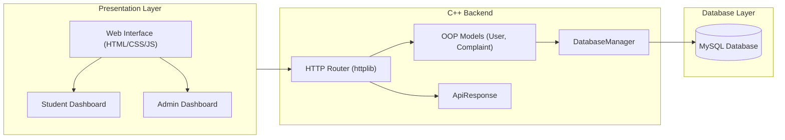
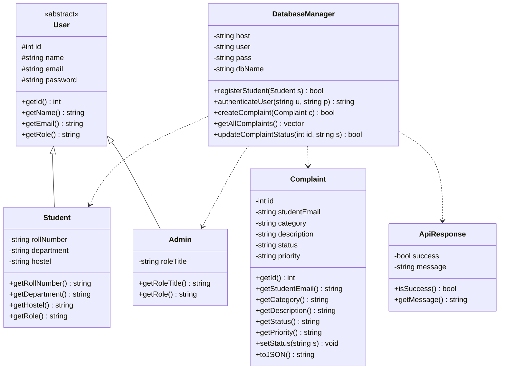
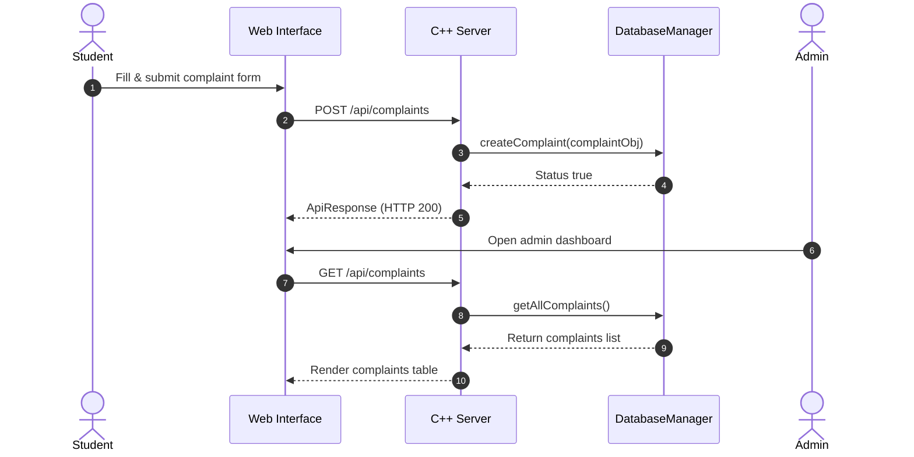
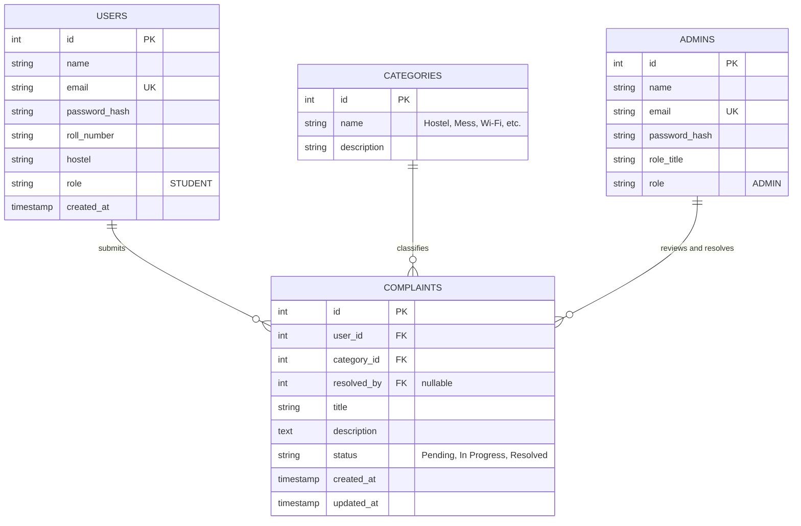

# 🏛️ Campus Complaint Management System

**Course:** CS3104 (Object-Oriented Programming) Mini-Project  
**Year:** 2nd Year B.Tech CSE  
**Team Members:**  
* Ajmeera Lokesh (`251102`)  
* Banavath Sushanth (`251111`)  

---

## 1. Project Abstract & Objectives
The **Campus Complaint Management System** is an academic mini-project developed to apply core software engineering and Object-Oriented Programming (OOP) principles—Encapsulation, Abstraction, Inheritance, and Polymorphism. 

Rather than tightly coupling business logic with the web interface or database queries, all domain entities, state transitions, and API responses are encapsulated within a pure, decoupled C++11 backend. This system digitizes campus infrastructure management, replacing manual paper registers with a centralized, role-based web platform for students and administrators.

---

## 2. Object-Oriented Architecture & UML

### 2.1 System Architecture
The project utilizes a decoupled, three-tier architecture exchanging standardized JSON payloads between the web client, the C++ REST server, and the MySQL database.

## Architecture Diagram



### 2.2 Class Hierarchy
The backend relies on strict OOP design. The base `User` class acts as an abstract contract, while derived classes specialize in role behaviors. 

## Class Diagram


## Sequence Diagram




---

## 3. Relational Persistence & Database Schema

The system utilizes a relational MySQL database ensuring data integrity through Foreign Keys and constrained status fields.

## Database Entity-Relationship (ER) Diagram



### 🗄️ Database Tables

**List of Tables in Database (`complaint_management`)**
| Table Name | Description |
| :--- | :--- |
| `students` | Stores registered student credentials and profiles. |
| `admins` | Stores administrator credentials and roles. |
| `complaints` | Main table storing all grievance tickets and resolution statuses. |
| `categories` | Stores predefined complaint types (e.g., Hostel, Wi-Fi, Mess). |
| `action_logs` | Audit trail for monitoring administrative actions. |
| `v_complaint_details` | SQL View used for aggregating complaint details with user data. |

**`students` Table (Data)**
| email | student_name | password |
| :--- | :--- | :--- |
| `251102@iiitt.ac.in` | Ajmeera Lokesh | `StrongPass@2026!Loki@2008` |
| `251111@iiitt.ac.in` | BANAVATH SUSHANTH | `sushanth@2007` |
| `s1@college.com` | Amit Kumar | `pass123` |

**`admins` Table (Data)**
| admin_id | email | password |
| :--- | :--- | :--- |
| `1` | `admin@college.com` | `StrongPass@2026!` |

**`complaints` Table (Data)**
| id | student_email | category_id | description | status | created_at |
| :--- | :--- | :--- | :--- | :--- | :--- |
| `1` | `s1@college.com` | `1` | Fan in room 204 is making loud noise. | Resolved | `2026-10-26 10:35:49` |
| `6` | `251112@iiitt.ac.in` | `5` | wifi not working in room no 330 | Resolved | `2026-10-26 10:53:33` |
| `7` | `251111@iiitt.ac.in` | `1` | wifi not working in room no : 329 | Resolved | `2026-10-26 10:56:18` |

---


---

## 4. Detailed Explanation of OOP Pillars

| Principle | Codebase Implementation |
| :--- | :--- |
| **Abstraction** | The `User` class is an Abstract Base Class (ABC) containing the pure virtual method `virtual std::string getRole() const = 0;`. |
| **Inheritance** | `Student` and `Admin` concretely inherit common attributes (ID, name, email) from the `User` base class, promoting code reuse. |
| **Polymorphism** | Dynamic dispatch is used at runtime to invoke the correct `getRole()` method depending on whether the authenticated entity is a Student or Admin. |
| **Encapsulation** | Sensitive attributes (passwords, internal ticket states) are declared as `private` or `protected`. They are mutated strictly through public setters/getters. |
| **Generic Programming** | A custom `ApiResponse<T>` template class standardizes HTTP responses across the backend for varying payload types (strings, vectors, JSON objects). |
| **Operator Overloading** | The stream insertion operator (`operator<<`) is overloaded for custom objects to facilitate formatted terminal logging and stream outputs. |

---

## 5. Technology Stack

* **Domain Engine:** C++11 (Object-Oriented native backend)
* **Web Server:** `cpp-httplib` (embedded REST HTTP router)
* **JSON Serialization:** `nlohmann/json` 
* **Database Layer:** MySQL 8.0+ & MySQL Connector/C++
* **Frontend Presentation:** HTML5, CSS3, Vanilla JavaScript (Fetch API)

---


## 6. How to Run & Verify

### Step 1: Database Setup
Launch your MySQL terminal and execute the schema:
```sql
CREATE DATABASE campus_complaints;
USE campus_complaints;
SOURCE database/schema.sql;
```

### Step 2: Compile the C++ Backend
Navigate to the project root directory and compile the server using C++11:

```Bash
g++ -std=c++11 main.cpp src/DatabaseManager.cpp -o server -lmysqlcppconn -lpthread
```
### Step 3: Launch the Server
Execute the compiled binary:

```Bash
./server
```
(The REST API will begin listening on http://localhost:8080)

Step 4: Access the Client
Open frontend/login.html in your web browser (or use VS Code Live Server) to access the application.


## 7. Project Structure

```text
.
├── backend/
│   ├── src/
│   │   ├── DatabaseManager.cpp    # DB connection & CRUD operations
│   │   └── models.cpp             # User, Student, Admin, Complaint classes
│   ├── main.cpp                   # API Routing & Server initialization
│   └── httplib.h                  # C++ HTTP framework
├── frontend/
│   ├── login.html                 # Unified authentication UI
│   ├── student_dashboard.html     # Ticket submission & history
│   └── admin_dashboard.html       # Aggregate metrics & triage
├── database/
│   └── schema.sql                 # MySQL DDL & Seed data
├── docs/
│   └── DIAGRAMS.md                # Markdown diagrams (Architecture, UML, ER)
├── report/
│   └── main.tex                   # LaTeX Project Report
└── README.md


