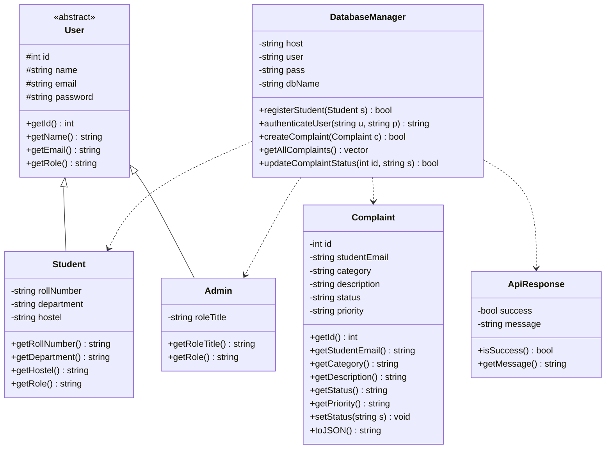
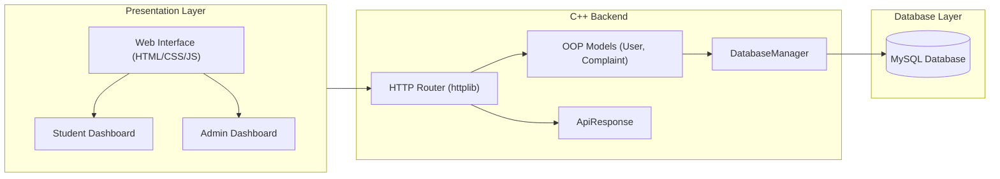
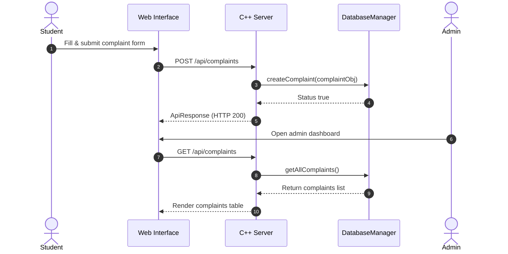

# 🏛️ Campus Complaint Management System

A full-stack, Object-Oriented grievance redressal platform designed for university campus environments. Built with a high-performance C++ REST API backend, relational MySQL database, and a responsive web frontend.

**Course:** CS3104 (Object-Oriented Programming) Mini-Project  
**Year:** 2nd Year B.Tech CSE  
**Team Members:**  
* Ajmeera Lokesh (`251102`)  
* Banavath Sushanth (`251111`)  

---

## 📌 Table of Contents
- [Overview & Objectives](#-overview--objectives)
- [System Architecture](#%EF%B8%8F-system-architecture)
- [Object-Oriented Design & Class Hierarchy](#-object-oriented-design--class-hierarchy)
- [OOP Principles Implemented](#-oop-principles-implemented)
- [Key Features & Modules](#-key-features--modules)
- [Tech Stack](#%EF%B8%8F-tech-stack)
- [API Reference](#-api-reference)
- [Installation & Quick Start](#-installation--quick-start)

---

## 📖 Overview & Objectives
Traditional paper registers for hostel and infrastructure maintenance are slow, unorganized, and lack transparency. **Campus Complaint Management System** digitizes this workflow. 
Students can log in, file categorized grievances, and track real-time resolution statuses. Administrators receive a consolidated dashboard to triage issues, update states, and manage campus infrastructure efficiently.

---

## ⚙️ System Architecture

The project utilizes a decoupled, three-tier architecture exchanging standardized JSON payloads between the web client, the C++ REST server, and the MySQL database.

# System Diagrams

## Class Diagram



## Architecture Diagram



## Sequence Diagram




---

## 🧩 Object-Oriented Design & Class Hierarchy

The backend relies on strict OOP design. The base `User` class acts as an abstract contract, while derived classes specialize in role behaviors. 

📊 **[View the UML Class Diagram and Sequence Flows in `docs/DIAGRAMS.md`](./docs/DIAGRAMS.md)**

---

## 💡 OOP Principles Implemented

| Principle | Implementation in Codebase |
| :--- | :--- |
| **Abstraction** | The `User` class is an abstract base class containing the pure virtual method `virtual std::string getRole() const = 0;`. |
| **Inheritance** | `Student` and `Admin` concretely inherit common attributes (ID, name, email) from the `User` base class. |
| **Polymorphism** | Dynamic dispatch is used at runtime to invoke the correct `getRole()` method depending on the authenticated entity. |
| **Encapsulation** | Sensitive attributes (passwords, ticket states) are declared as `private` or `protected`, mutated strictly through public setters. |
| **Generics (Templates)** | A custom `ApiResponse<T>` template class standardizes HTTP responses for varying payload types (strings, vectors, objects). |
| **Operator Overloading** | Overloaded `operator<<` for easy serialization and console logging of response objects. |

---

## ✨ Key Features & Modules

### 🎓 Student Portal
* **Role-Based Auth:** Secure login utilizing standard credentials.
* **Grievance Lodging:** Submit categorized complaints (`Hostel`, `Mess`, `Wi-Fi`, `Electricity`, `Classroom`, `Lab`).
* **Live Tracking:** Monitor ticket transitions from `Submitted` $\rightarrow$ `Under Review` $\rightarrow$ `In Progress` $\rightarrow$ `Resolved`.

### 🛡️ Administrator Dashboard
* **Metrics Console:** View aggregate complaint counts using SQL `GROUP BY` analytics.
* **Registry Management:** Centralized table pulling from `v_complaint_details` to view, assign, and resolve campus issues.
* **Status Updates:** One-click transition of complaint statuses with database persistence.

---

## 🛠️ Tech Stack
* **Frontend:** HTML5, CSS3, Vanilla JavaScript (Fetch API)
* **Backend:** C++11
* **HTTP Framework:** `cpp-httplib`
* **JSON Serialization:** `nlohmann/json`
* **Database:** MySQL 8.0+
* **Database Driver:** MySQL Connector/C++

---

## 📡 API Reference
| Method | Endpoint | Description | Payload |
| :--- | :--- | :--- | :--- |
| `POST` | `/api/login` | Authenticate Student/Admin | `{ "email": "...", "password": "..." }` |
| `POST` | `/api/complaints` | Submit a new grievance | `{ "student_id": 1, "category": "...", "desc": "..." }` |
| `GET` | `/api/complaints` | Fetch complaint history | None |
| `PUT` | `/api/complaints/:id` | Update complaint status | `{ "status": "Resolved" }` |

---

## 🚀 Installation & Quick Start

### 1. Database Setup
Ensure MySQL is running. Open your MySQL CLI or Workbench:
```sql
CREATE DATABASE campus_complaints;
USE campus_complaints;
-- Import your schema here
SOURCE database/schema.sql;

2. Compile the C++ Backend
Navigate to the backend directory and compile using g++:

Bash
g++ -std=c++11 main.cpp src/DatabaseManager.cpp -o server -lmysqlcppconn -lpthread
3. Run the Server
Execute the compiled binary:

Bash
./server
(Server will start on http://localhost:8080)

4. Launch the Frontend
Open frontend/login.html in any modern web browser or use VS Code Live Server to begin interacting with the platform.
